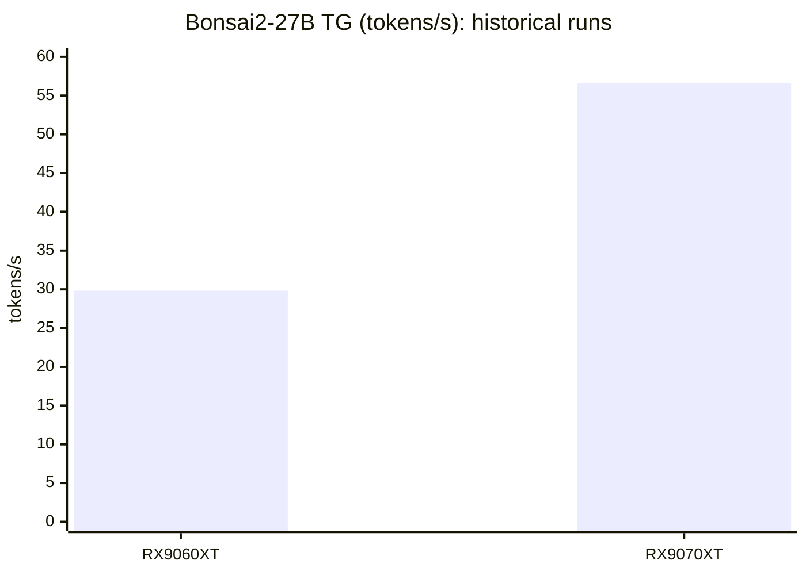

# Bonsai 2 27B — Windows 11 / Radeon RX 9060 XT・9070 XT

## TL;DR

**Bonsai 2 27B PQ2_0 works on both RX 9060 XT and RX 9070 XT with PrismML llama.cpp / Vulkan.**

| GPU (16 GB) | PP | TG | Status |
|---|---:|---:|---|
| **RX 9070 XT** | **743.67 t/s** | **56.60 t/s** | Verified |
| **RX 9060 XT** | **44.16 t/s** | **29.83 t/s** | Verified, historical run |

※ **RX 9060 XTのPP低速はPCIe 3.0 x1環境に由来する可能性があります。**

Numbers come from different workloads; they are not a controlled same-condition comparison. **All Windows installation and test commands below target Windows PowerShell 5.1.**

## 1. 環境設定

| Item | Tested configuration |
|---|---|
| OS / Shell | Windows 11 Pro x64 / **Windows PowerShell 5.1** |
| CPU / RAM | AMD Ryzen 7 5700X / 32 GB |
| Motherboard | ASUS TUF GAMING B550-PLUS |
| Main GPU | RX 9070 XT 16GB, primary PCIe 4.0 x16 slot (Vulkan1 at test time) |
| Secondary GPU | RX 9060 XT 16GB, PCIe 3.0 x1 configured for USB bandwidth (Vulkan0) |
| Driver | AMD Adrenalin **26.3.1** |
| Engine | PrismML llama.cpp **build 10772**, commit **e8fd209c9**, Vulkan |
| Power profile | RX9070XT power limit -30%; offsets -65 and -500 are saved but not marked enabled in XML |

```powershell
$PSVersionTable.PSVersion
Get-CimInstance Win32_VideoController | Select-Object Name,DriverVersion
```

## 2. Installs (Windows PowerShell 5.1)

```powershell
# Skip packages already installed.
winget install -e --id Git.Git --accept-package-agreements --accept-source-agreements
winget install -e --id Python.Python.3.11 --accept-package-agreements --accept-source-agreements
# Open a new PowerShell 5.1 window after installing.
git --version
py -3.11 --version
Set-ExecutionPolicy -Scope Process -ExecutionPolicy Bypass -Force
```

The Vulkan runtime comes with a compatible AMD GPU driver. A Vulkan SDK is **not required merely to run** prebuilt llama.cpp. The repository-wide setup.ps1 auto-detects a backend and might select HIP or CPU, so the following instructions explicitly install the fixed Vulkan release.

## 3. 参照した llama.cpp と導入コマンド

Source: [PrismML-Eng/llama.cpp](https://github.com/PrismML-Eng/llama.cpp). Pinned release: [prism-b10772-e8fd209](https://github.com/PrismML-Eng/llama.cpp/releases/tag/prism-b10772-e8fd209).

The measured PC used a **locally built binary** in D:\AI\PrismML\dev\llama.cpp\build-vulkan-ucrt64\bin; the following commands install the matching published release series, not an identical SHA256 executable.

```powershell
$work = "D:\AI\PrismML\dev"  # Change this directory on another machine.
New-Item -ItemType Directory -Force $work | Out-Null
Set-Location $work
git clone https://github.com/arnatoatadaink/Bonsai-demo.git
Set-Location .\Bonsai-demo
git fetch origin
git switch reports/bonsai2-27b-rx9070xt-20261016
$tag = "prism-b10772-e8fd209"
$base = "https://github.com/PrismML-Eng/llama.cpp/releases/download/$tag"
$dest = Join-Path (Get-Location) "bin\vulkan"
New-Item -ItemType Directory -Force $dest | Out-Null
$cpuZip = Join-Path $env:TEMP "bonsai-llama-cpu.zip"
$vkZip = Join-Path $env:TEMP "bonsai-llama-vulkan.zip"
Invoke-WebRequest -UseBasicParsing -Uri "$base/llama-$tag-bin-win-cpu-x64.zip" -OutFile $cpuZip
Invoke-WebRequest -UseBasicParsing -Uri "$base/llama-$tag-bin-win-vulkan-x64.zip" -OutFile $vkZip
Expand-Archive -LiteralPath $cpuZip -DestinationPath $dest -Force
Expand-Archive -LiteralPath $vkZip -DestinationPath $dest -Force
$server = Join-Path $dest "llama-server.exe"
Test-Path $server
& $server --list-devices
```

These asset names follow the repository setup.ps1 at the pinned tag. Check availability, DLL placement, and --list-devices on the new machine; the packaged binary has not been validated there yet.

## 4. 参照したモデルと導入コマンド

Model: [prism-ml/Ternary-Bonsai-2-27B-gguf](https://huggingface.co/prism-ml/Ternary-Bonsai-2-27B-gguf), **PQ2_0**, tested model size 7,206,168,928 bytes.

```powershell
py -3.11 -m venv .venv
$py = Join-Path (Get-Location) ".venv\Scripts\python.exe"
& $py -m pip install --upgrade pip "huggingface_hub[cli]"
$modelDir = Join-Path (Get-Location) "models\bonsai2-gguf\27B"
New-Item -ItemType Directory -Force $modelDir | Out-Null
$hf = Join-Path (Get-Location) ".venv\Scripts\hf.exe"
& $hf download prism-ml/Ternary-Bonsai-2-27B-gguf --include "*-PQ2_0.gguf" --local-dir $modelDir
$gguf = (Get-ChildItem -LiteralPath $modelDir -Filter "*-PQ2_0.gguf" -File | Select-Object -First 1).FullName
Test-Path $gguf
Get-Item $gguf | Select-Object FullName,Length
```

Image input is not used for this text-only benchmark; mmproj is optional. Existing tested model location was D:\lmstudio_models\prism-ml\Ternary-Bonsai-2-27B-gguf\Ternary-Bonsai-2-27B-PQ2_0.gguf.

## 5. 起動・動作確認方法

The actual Vulkan device indices vary by PC: use --list-devices before choosing the ID. Start one GPU server at a time, without MTP.

```powershell
& $server --list-devices
$device = "Vulkan1" # Set to the RX 9070 XT device reported on THIS PC.
& $server -m $gguf --host 127.0.0.1 --port 18081 --device $device -ngl 99 -sm none -c 4096 --cache-type-k q8_0 --cache-type-v q8_0 -fa on -np 1 --jinja
```

In a **second** PowerShell window:

```powershell
Invoke-RestMethod http://127.0.0.1:18081/health
Invoke-RestMethod http://127.0.0.1:18081/v1/models
$body = @{messages=@(@{role="system";content="You are a helpful assistant."},@{role="user";content="Explain why 1+1=2 in Japanese."});max_tokens=1024;temperature=1.0;top_p=0.95;stream=$false} | ConvertTo-Json -Depth 10
$r = Invoke-RestMethod -Method Post -Uri http://127.0.0.1:18081/v1/chat/completions -ContentType "application/json; charset=utf-8" -Body ([Text.Encoding]::UTF8.GetBytes($body))
$r.choices[0].message
$r.timings | Format-List
```

Stop that server before the automated single-run RX9070XT performance probe:

```powershell
.\reports\verify_bonsai2_rx9070xt.ps1 -ModelPath $gguf -LlamaServer $server -Context 4096 -MaxTokens 2048
```

That script is RX9070XT-only. Do not use it to claim RX9060XT measurements.

## 6. 動作証跡・速度

| GPU | Context | Prompt tokens | Generated tokens | PP t/s | TG t/s |
|---|---:|---:|---:|---:|---:|
| RX 9070 XT | **4,096** | **2,292** | **1,804** | **743.67** | **56.60** |
| RX 9060 XT (historical) | Not reconciled | Not reconciled | Not reconciled | 44.16 | 29.83 |

**No context-length sweep has been recorded for Bonsai2-27B on RX9070XT.** Do not infer 8K/32K/64K throughput from the 4K run. The chart below shows the only available TG comparison (different measurement conditions):



RX9070XT timing detail: PP 2,292 tokens / 3,082.014 ms; TG 1,804 tokens / 31,857.099 ms. Completion ended at 4,096 tokens combined (finish_reason=length); sustained reasoning-token generation was verified, **not completed final-answer output**.

Original evidence archive: bonsai2_rx9070xt_20261016_144533.zip (user-provided, not committed). Model SHA256: 3907DC1658DB1F78A9826BF8D5BCB8DC65DB0D466388937AF57F2294FAE62EC1. Measured local-binary SHA256: 1BF104B2C3274899EF20BA92AFFDBBDAFB6CFD0903621C2492E702A284D16FEE.

**PCIe note:** B550-PLUS primary CPU PCIe 4.0 x16 vs secondary configured chipset PCIe 3.0 x1 (USB bandwidth preservation). PP difference may be environment-specific, not intrinsic GPU performance. RX9070XT VRAM bandwidth 640 GB/s, RX9060XT 320 GB/s. RX9060XT TG ~29.83 vs RX9070XT ~56.60 t/s cannot establish exact GPU scaling without matching test conditions.

Power XML: -30% power limit enabled; saved -65 / -500 offsets have state disabled. Detailed GPU provenance: [VERIFIED_GPU_STATUS.md](VERIFIED_GPU_STATUS.md). Gemma/Qwen comparisons and MTP stability are deliberately excluded.